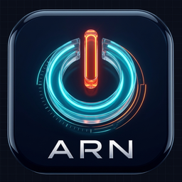

# ⚡ منظومة ARN Shutdown Panel المتكاملة (إدارة الطاقة والتحكم عن بعد)
### ARN Shutdown Panel — Ultimate Remote Power Management & System Control Ecosystem

<div align="center">



**الإصدار:** v2.0.0 • **المطور:** عبده رجب نصار • **الشركة:** ARN Technology  
**الهوية:** تصميم عصري فاخر (Dark Glassmorphic UI) مع أداء عالي وسرعة استجابة فائقة.

[](https://python.org/)
[](https://pywebview.flowrl.com/)
[](https://riverbankcomputing.com/software/pyqt/)
[](LICENSE)
[](build_and_sign.ps1)

</div>

---

## 🌟 نظرة عامة عن المنظومة (Overview)

منظومة **ARN Shutdown Panel** هي حل برمجي هندسي متقدم وشامل لإدارة وتأمين طاقة أجهزة الحاسوب والتحكم الكامل بها عن بُعد داخل الشبكة المحلية (LAN). تم بناء النظام بأحدث تقنيات **Python** وواجهة زجاجية عصرية فائقة السلاسة بالاعتماد على **Edge WebView2 (PyWebView)**، مع تزويده بخادم محلي فائق السرعة، وعميل ديسكتوب ذكي، وواجهة ويب جوال كاملة (PWA) تتيح بث الشاشة التفاعلي، ونقل الملفات، وإدارة العمليات بدقة متناهية.

---

## ✨ الميزات الرئيسية (Core Features)

### 1. ⚡ التحكم الشامل بالطاقة والمهام (Power & Automation)
- **تنفيذ فوري ودقيق لأوامر النظام:** إيقاف التشغيل الكامل، إعادة التشغيل، النوم السريع، الإسبات، قفل النظام، وتسجيل الخروج.
- **محرك عدّاد تنازلي فائق الدقة (Monotonic Deadline Engine):** يعمل بخيط مستقل (Thread-safe) لا يتأثر بتغييرات وقت النظام، مع دعم الإيقاف المؤقت، الاستئناف، والتنبيهات الصوتية الفاخرة.
- **جدولة أسبوعية ذكية:** ضبط مواعيد متكررة لتنفيذ إجراءات الطاقة تلقائياً (مثل إيقاف تشغيل الأجهزة يومياً في تمام الساعة 23:00).
- **التحكم بأجهزة الشبكة (Remote Command Execution):** إيقاف أو إسبات الحواسيب الأخرى المرتبطة بالشبكة بنقرة زر واحدة.

### 2. 📱 التحكم اللاسلكي عن بعد وبث الشاشة (LAN Remote & Screen Streaming)
- **واجهة ويب عصرية متجاوبة للجوال (PWA):** تعمل مباشرة من أي متصفح هاتف مع إمكانية تثبيتها كتطبيق مستقل على الشاشة الرئيسية.
- **اتصال فوري وآمن عبر QR Code:** اقتران لحظي بمجرد مسح الرمز بكاميرا الهاتف بدون أي تعقيدات شبكية.
- **بث شاشة مباشر عالي الدقة (Real-time MJPEG Stream):** مع تفاعل لمسي مباشر للنقر والتحكم في سطح المكتب عن بُعد، والتقاط صور فورية للشاشة.
- **لوحة لمس (Virtual Trackpad) ولوحة مفاتيح كاملة:** دعم كامل للغة العربية والإنجليزية، مع تنفيذ جميع الاختصارات السريعة (`Ctrl+C`, `Alt+Tab`, `Win+D`).

### 3. 📁 مدير ملفات متطور ومراقب العمليات (File Explorer & Task Manager)
- **مدير ملفات كامل:** استعراض الأقراص والمجلدات، رفع الملفات بسلاسة، تحميل الملفات، ضغط المجلدات بصيغة ZIP، وتغيير الأسماء.
- **الحذف الآمن إلى سلة المحذوفات (Safe Recycle Bin):** حماية كاملة للملفات وتجنب الحذف النهائي الخاطئ.
- **مراقب العمليات والعتاد (Real-time Task & Hardware Monitor):** عرض حي ودقيق لنسب استهلاك المعالج (CPU)، الذاكرة (RAM)، التخزين، البطارية، وزمن تشغيل الجهاز مع إمكانية إنهاء أي عملية مستهلكة.

### 4. 🛡️ الأمان والحماية والشبكات (Security, WOL & HTTPS)
- **حماية مشددة بالرموز (Token-based Authentication):** إغلاق تام لنقاط النهاية، ومنع CORS المفتوح، وتدوير دوري لرموز المصادقة.
- **اتصال مشفر (Optional HTTPS):** توليد تلقائي للشهادات الأمنية وتشفير كامل لحركة البيانات بين الحاسوب والهاتف.
- **ميزة إيقاظ الأجهزة عن بُعد (Wake-on-LAN):** إرسال حزم الإيقاظ السحرية (Magic Packets) لتشغيل الحواسيب المغلقة عبر الشبكة.
- **ويدجت ساعة زجاجي عائم (Floating Glass Clock Widget):** ويدجت مستقل يلتصق بحافة الشاشة يعرض الوقت وحالة العد التنازلي بجمالية استثنائية.

---

## 📁 الهيكلية البرمجية للمشروع (Project Structure)

```
ShutdownPanel/
├── requirements.txt           # تبعيات التشغيل والمكتبات الأساسية
├── requirements-dev.txt       # أدوات التطوير والاختبارات
├── main.py                    # نقطة تشغيل المنظومة الرئيسية (الخادم + النافذة + Tray)
├── client_main.py             # نقطة انطلاق عميل سطح المكتب للتحكم عن بُعد
├── build_exe.py               # سكربت البناء والتجميع الآلي (Standalone & Setup)
├── build_and_sign.ps1         # سكربت التوقيع الرقمي المعتمد لـ ARN Technology
├── installer.iss              # سكربت حزمة التثبيت الاحترافية (Inno Setup)
├── core/                      # محركات النظام الخلفية
│   ├── commander.py           # تخطيط وتنفيذ أوامر النظام والشبكة
│   ├── scheduler.py           # محرك العد التنازلي الأحادي
│   ├── schedules.py           # محرك الجدولة الزمنية الأسبوعية
│   ├── metrics.py             # قراءة ومراقبة استهلاك العتاد
│   ├── input_controller.py    # محاكاة وتوجيه المدخلات (Mouse & Keyboard)
│   ├── screen_streamer.py     # محرك التقاط وبث الشاشة اللحظي
│   ├── remote_server.py       # خادم الويب المحلي فائق السرعة
│   ├── discovery.py           # بروتوكول الاكتشاف التلقائي عبر الشبكة (UDP)
│   ├── wol.py                 # محرك Wake-on-LAN
│   ├── clipboard_utils.py     # مزامنة نصوص الحافظة
│   ├── settings.py            # إدارة وحفظ الإعدادات بنظام JSON
│   ├── app_logger.py          # نظام السجلات الدوار المتقدم
│   └── version.py             # معلومات الإصدار والهوية
├── gui/                       # واجهات المستخدم
│   ├── api.py                 # جسر الربط بين Python وواجهة الويب
│   ├── client_api.py          # جسر واجهة العميل البعيد
│   ├── web/                   # واجهة اللوحة الرئيسية (HTML / JS / CSS)
│   │   ├── index.html         # الواجهة الرئيسية الزجاجية
│   │   ├── widget.html        # ويدجت الساعة العائم
│   │   ├── mobile.html        # واجهة الجوال التفاعلية (PWA)
│   │   └── fonts/             # الخطوط العربية والإنجليزية محلياً بدون إنترنت
│   └── client_web/            # واجهة عميل سطح المكتب المستقل
└── tests/                     # منظومة الاختبارات الآلية الشاملة
```

---

## 🚀 التثبيت والتشغيل (Quick Start)

### 1. تثبيت المتطلبات البرمجية
```bash
pip install -r requirements.txt
# اختياري — لدعم تشفير اتصالات HTTPS:
pip install cryptography
```

### 2. تشغيل لوحة التحكم الرئيسية (Host Server)
```bash
python main.py
```

### 3. تشغيل عميل التحكم عن بُعد (من حاسوب آخر على الشبكة)
```bash
python client_main.py
```

### 4. الاقتران من الهاتف المحمول
1. افتح تبويب **التحكم عن بُعد** من اللوحة الرئيسية وقم بتفعيل الخادم.
2. امسح **رمز الاستجابة السريعة (QR Code)** بكاميرا هاتفك.
3. استمتع بالتحكم الكامل في حاسوبك، مع إمكانية تثبيت الصفحة كتطبيق جوال (PWA).

---

## 📦 التجميع كملف تنفيذي وحزمة تثبيت (Build & Package)

يمكن بناء المنظومة وتوليد حزم التثبيت التنفيذية الموقعة رقمياً بأمر واحد:
```bash
python build_exe.py
```
المخرجات المتولدة داخل مجلد `dist/`:
- `ShutdownPanel_Setup_v2.0.0.exe`: **حزمة التثبيت الموحدة** عبر Inno Setup والموقعة رقمياً.
- `ShutdownPanel.exe`: نسخة محمولة بالكامل للوحة الرئيسية (Standalone).
- `ShutdownPanelClient.exe`: نسخة محمولة لعميل التحكم عن بُعد.

---

## 📄 الترخيص وحقوق الملكية (License)

جميع الحقوق محفوظة © 2026 لشركة **ARN Technology** والمطور **عبده رجب نصار**.  
يُحظر نسخ أو تعديل أو إعادة توزيع هذا البرنامج أو أي جزء من شيفرته المصدرية دون إذن كتابي مسبق.  
راجع ملف [LICENSE](LICENSE) لمزيد من التفاصيل.
